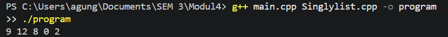
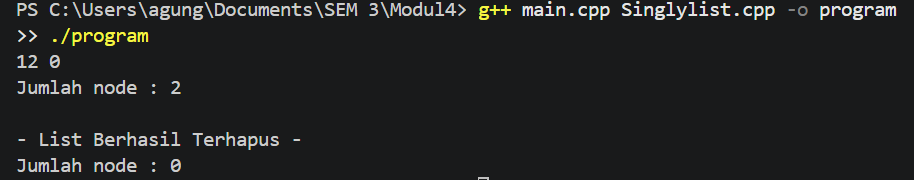

# <h1 align="center">Laporan Praktikum Modul 4 - Singly Linked List</h1>
<p align="center"> AgungTriUtomo - 109082500048</p>

## Dasar Teori

Linked list atau yang disebut juga senarai berantai adalah salah satu bentuk struktur data yang berisi kumpulan data yang tersusun secara sekuensial, saling bersambungan, dinamis, dan terbatas[1]. Linked list terdiri dari sejumlah node atau simpul yang dihubungkan secara linier dengan bantuan pointer. Berbeda dengan array yang ukurannya tetap dan elemennya berada pada alamat memori yang berurutan, linked list dialokasikan secara dinamis sehingga ukurannya dapat bertambah dan berkurang saat program berjalan[1].

### A. Singly Linked List<br/>
Singly linked list adalah linked list yang setiap node-nya hanya memiliki satu pointer, yaitu pointer `next` yang menunjuk ke node berikutnya. Node pertama ditunjuk oleh pointer `First` (head), sedangkan node terakhir memiliki `next` bernilai `Nil` (NULL) sebagai penanda akhir list. Penelusuran hanya bisa dilakukan satu arah, dari node pertama sampai node terakhir.

#### 1. Struktur Node dan List
Setiap node (`ElmList`) terdiri dari dua bagian: `info` yang menyimpan data bertipe `infotype`, dan `next` bertipe `address` (pointer ke `ElmList`) yang menyimpan alamat node berikutnya. List (`List`) hanya menyimpan satu pointer, yaitu `First`.

#### 2. Alokasi dan Dealokasi
Alokasi adalah proses membuat node baru di memori (menggunakan `new`) dan mengisi `info` serta mengatur `next` menjadi `Nil`. Dealokasi adalah proses melepaskan memori node yang sudah tidak dipakai (menggunakan `delete`) agar tidak terjadi kebocoran memori (*memory leak*).

#### 3. Operasi Dasar
Operasi dasar pada singly linked list meliputi penyisipan (insert) dan penghapusan (delete) node, serta penelusuran (traversal) untuk menampilkan isi list dan menghitung jumlah node.

### B. Operasi pada Singly Linked List<br/>
#### 1. Insert First
Menyisipkan node baru di awal list. Node baru menunjuk ke node yang sebelumnya adalah `First`, lalu `First` dipindahkan ke node baru tersebut.

#### 2. Delete First, Delete Last, dan Delete After
- **Delete First**: menghapus node pertama; `First` dipindahkan ke node berikutnya.
- **Delete Last**: menghapus node terakhir; node sebelum node terakhir dicari terlebih dahulu lalu `next`-nya diubah menjadi `Nil`.
- **Delete After**: menghapus node yang berada tepat setelah node tertentu (`Prec`); `next` dari `Prec` disambungkan ke node setelah node yang dihapus.

#### 3. Penelusuran (Traversal), Hitung Node, dan Hapus List
Penelusuran dilakukan dengan pointer bantu yang bergerak dari `First` sampai `Nil`. Cara ini dipakai oleh `printInfo` (menampilkan isi), `nbList` (menghitung jumlah node), dan `deleteList` (menghapus seluruh node satu per satu).

## Guided
## 1 List.cpp

## 2 List.h

## 3 Main.cpp


## Unguided

### 1. Membuat ADT Singly Linked List (`Singlylist.h`, `Singlylist.cpp`) dan program utama (`main.cpp`)

**Singlylist.h**
```C++
#ifndef SINGLYLIST_H
#define SINGLYLIST_H

#include <iostream>
using namespace std;

#define Nil NULL

typedef int infotype;
typedef struct ElmList *address;

struct ElmList {
    infotype info;
    address next;
};

struct List {
    address First;
};

void createList(List &L);
address alokasi(infotype x);
void dealokasi(address &P);
void printInfo(List L);
void insertFirst(List &L, address P);

#endif
```

**Singlylist.cpp**
```C++
#include "Singlylist.h"

void createList(List &L) {
    L.First = Nil;
}

address alokasi(infotype x) {
    address P = new ElmList;
    P->info = x;
    P->next = Nil;
    return P;
}

void dealokasi(address &P) {
    delete P;
    P = Nil;
}

void printInfo(List L) {
    address P = L.First;
    while (P != Nil) {
        cout << P->info << " ";
        P = P->next;
    }
    cout << endl;
}

void insertFirst(List &L, address P) {
    P->next = L.First;
    L.First = P;
}
```

**main.cpp**
```C++
#include "Singlylist.h"

int main() {
    List L;
    address P1, P2, P3, P4, P5 = Nil;
    createList(L);

    P1 = alokasi(2);
    insertFirst(L, P1);

    P2 = alokasi(0);
    insertFirst(L, P2);

    P3 = alokasi(8);
    insertFirst(L, P3);

    P4 = alokasi(12);
    insertFirst(L, P4);

    P5 = alokasi(9);
    insertFirst(L, P5);

    printInfo(L);
    return 0;
}
```
### Output Unguided 1 :

##### Output 1


Program ini membuat ADT singly linked list yang dipisah menjadi tiga file. `Singlylist.h` berisi deklarasi tipe (`infotype`, `address`, `ElmList`, `List`) beserta prototipe prosedur. `Singlylist.cpp` berisi implementasinya: `createList` mengosongkan list dengan mengisi `First` dengan `Nil`, `alokasi` membuat node baru dengan `new` lalu mengisi `info` dan `next`, `dealokasi` melepas memori node dengan `delete`, `printInfo` menelusuri list dari `First` sampai `Nil` sambil mencetak `info`, dan `insertFirst` menyisipkan node di awal list. Pada `main.cpp`, lima node (2, 0, 8, 12, 9) disisipkan satu per satu menggunakan `insertFirst`. Karena setiap node baru selalu menjadi node pertama, urutan dalam list menjadi kebalikan dari urutan penyisipan, sehingga output yang tampil adalah `9 12 8 0 2`.

### 2. Penghapusan node dengan `deleteFirst()`, `deleteLast()`, `deleteAfter()`, serta `nbList()` dan `deleteList()`


```C++
void deleteFirst(List &L, address &P);
void deleteLast(List &L, address &P);
void deleteAfter(address Prec, address &P);
int nbList(List L);
void deleteList(List &L);
```


```C++
void deleteFirst(List &L, address &P) {
    if (L.First != Nil) {
        P = L.First;
        L.First = P->next;
        P->next = Nil;
    }
}

void deleteLast(List &L, address &P) {
    if (L.First != Nil) {
        if (L.First->next == Nil) {
            // hanya satu node
            P = L.First;
            L.First = Nil;
        } else {
            address Q = L.First;
            while (Q->next->next != Nil) {
                Q = Q->next;
            }
            P = Q->next;
            Q->next = Nil;
        }
    }
}

void deleteAfter(address Prec, address &P) {
    if (Prec != Nil && Prec->next != Nil) {
        P = Prec->next;
        Prec->next = P->next;
        P->next = Nil;
    }
}

int nbList(List L) {
    int jumlah = 0;
    address P = L.First;
    while (P != Nil) {
        jumlah++;
        P = P->next;
    }
    return jumlah;
}

void deleteList(List &L) {
    address P;
    while (L.First != Nil) {
        deleteFirst(L, P);
        dealokasi(P);
    }
    cout << "- List Berhasil Terhapus -" << endl;
}
```

**main.cpp**
```C++
#include "Singlylist.h"

int main() {
    List L;
    address P1, P2, P3, P4, P5 = Nil;
    address P;
    createList(L);

    P1 = alokasi(2);
    insertFirst(L, P1);
    P2 = alokasi(0);
    insertFirst(L, P2);
    P3 = alokasi(8);
    insertFirst(L, P3);
    P4 = alokasi(12);
    insertFirst(L, P4);
    P5 = alokasi(9);
    insertFirst(L, P5);
    // List: 9 12 8 0 2

    deleteFirst(L, P);          
    dealokasi(P);

    deleteLast(L, P);           
    dealokasi(P);

    deleteAfter(L.First, P);    
    dealokasi(P);

    printInfo(L);
    cout << "Jumlah node : " << nbList(L) << endl;

    cout << endl;
    deleteList(L);
    cout << "Jumlah node : " << nbList(L) << endl;

    return 0;
}
```
### Output Unguided 2 :

##### Output 1


Pada soal kedua, list dari soal pertama (`9 12 8 0 2`) dimodifikasi dengan operasi penghapusan. `deleteFirst` menghapus node 9 sehingga list menjadi `12 8 0 2`. `deleteLast` menelusuri list sampai node sebelum terakhir lalu memutus node 2, sehingga list menjadi `12 8 0`. `deleteAfter(L.First, P)` menghapus node yang berada setelah node 12, yaitu node 8, dengan menyambungkan `next` node 12 langsung ke node 0, sehingga list menjadi `12 0`. Fungsi `nbList` menghitung node dengan traversal dan menghasilkan 2. Terakhir, `deleteList` menghapus seluruh node secara berulang menggunakan `deleteFirst` dan `dealokasi` sampai `First` bernilai `Nil`, lalu mencetak pesan berhasil, sehingga `nbList` berikutnya menghasilkan 0. Setiap node yang dilepas dari list juga didealokasi agar memori tidak bocor.

## Kesimpulan
Singly linked list adalah struktur data dinamis yang tiap node-nya menyimpan data dan pointer ke node berikutnya. Pada praktikum ini, operasi insert, delete, hitung node, dan hapus list berhasil diimplementasikan dalam bentuk ADT, dan hasil program sesuai dengan output yang diharapkan.

## Referensi
[1] Triase. (2020). Diktat Edisi Revisi : STRUKTUR DATA. Medan: UNIVERSTAS ISLAM NEGERI SUMATERA UTARA MEDAN. 
<br>[2] Indahyati, Uce., Rahmawati Yunianita. (2020). "BUKU AJAR ALGORITMA DAN PEMROGRAMAN DALAM BAHASA C++". Sidoarjo: Umsida Press. Diakses pada 10 Maret 2024 melalui https://doi.org/10.21070/2020/978-623-6833-67-4.
[3] PENS, "Praktikum 15-16: Single linked list," Politeknik Elektronika Negeri Surabaya. Available: https://arna.lecturer.pens.ac.id/PrakASD_Java/Praktikum%2015-16%20-%20SingleLinkedList.pdf
[4] M. T. Ahmmed, "Introduction to linked list data structures with its applications: Singly and circular linked list," ResearchGate, Oct. 2024. Available: https://www.researchgate.net/publication/385423187_Introduction_to_Linked_List_Data_Structures_with_it's_applications_Singly_and_Circular_Linked_List
